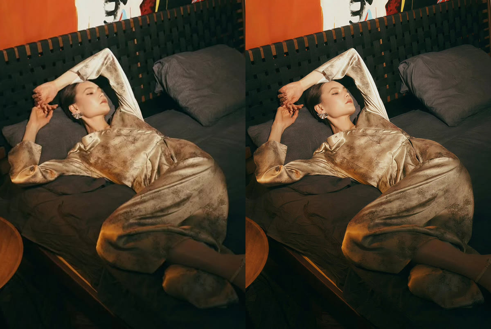
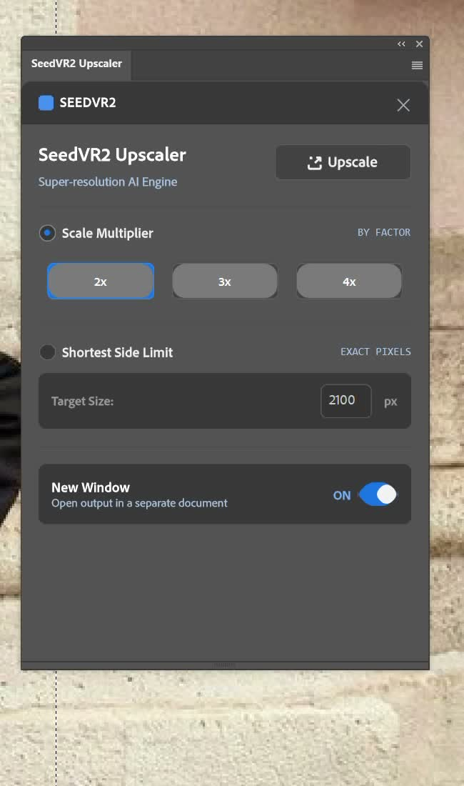
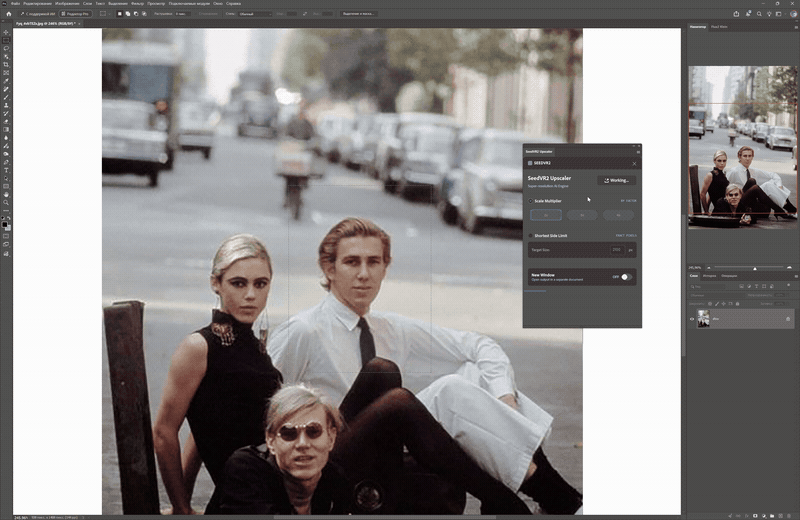

# SeedVR2 Upscaler for Adobe Photoshop

Локальный AI-апскейлер для Adobe Photoshop, который связывает компактную UXP-панель с вашим ComfyUI и SeedVR2.

Плагин умеет увеличивать весь документ, улучшать только выделенную область, возвращать результат в исходный Photoshop-документ или открывать его в новом окне. После установки моделей обработка выполняется локально на компьютере.

Слева исходник, справа результат SeedVR2:



<p align="center">
  
</p>

## Скачать

- [Скачать комплект установки для Windows ZIP](https://github.com/kuznetsovphotographer-prog/photoshop-seedvr2-plugin/raw/main/ccx/SeedVR2-Upscaler-v0.1.1-Windows.zip)
- [Скачать готовый CCX-пакет v0.1.1](https://github.com/kuznetsovphotographer-prog/photoshop-seedvr2-plugin/raw/main/ccx/com.local.photoshop.seedvr2-upscaler_PS.ccx)
- [Скачать BAT-установщик для Windows](https://github.com/kuznetsovphotographer-prog/photoshop-seedvr2-plugin/raw/main/ccx/INSTALL_SEEDVR2_UPSCALER.bat)
- [Скачать BAT-файл удаления](https://github.com/kuznetsovphotographer-prog/photoshop-seedvr2-plugin/raw/main/ccx/UNINSTALL_SEEDVR2_UPSCALER.bat)
- [Скачать API workflow для ComfyUI](https://github.com/kuznetsovphotographer-prog/photoshop-seedvr2-plugin/raw/main/workflows/workflows-for-comfyui/seedvr2_simple_image_upscale_api.json)

Полная инструкция: [docs/INSTALLATION_RU.md](docs/INSTALLATION_RU.md).

## Демонстрация

Ниже показана локальная обработка выделенной области и возврат результата в Photoshop новым слоем.



Оригинальный ролик в MP4: [local-selection-demo.mp4](media/video/local-selection-demo.mp4).

## Возможности

- увеличение всего изображения в `2x`, `3x` или `4x`;
- точный размер короткой стороны через `Shortest Side Limit`;
- максимальная короткая сторона результата: `2500 px`;
- обработка прямоугольного выделения или bounding box произвольного выделения;
- возврат локально улучшенного фрагмента новым слоем;
- открытие готового изображения отдельным Photoshop-документом;
- прогресс ComfyUI прямо в нижней полосе панели;
- остановка текущей генерации кнопкой `Stop`;
- запись запуска плагина в Photoshop Actions для повторной и пакетной обработки;
- локальная передача PNG в ComfyUI по адресу `http://127.0.0.1:8188`.

## Четыре режима вывода

| Выделение | `New Window OFF` | `New Window ON` |
| --- | --- | --- |
| Нет | Текущий документ заменяется увеличенной версией. Одно Undo восстанавливает исходное состояние. | Результат открывается новым документом, исходник не меняется. |
| Есть | Выделенная область улучшается и возвращается в исходные границы новым слоем `SeedVR2 Upscale`. | Увеличенная область открывается отдельным документом. |

Оба режима размера работают во всех четырех сценариях:

- `Scale Multiplier`: `2x`, `3x`, `4x`;
- `Shortest Side Limit`: от `500` до `2500 px` по короткой стороне.

Если выбранный множитель дает больше `2500 px` по короткой стороне, плагин автоматически ограничивает цель до `2500 px`. Длинная сторона сохраняет пропорции и отдельно не ограничивается.

## Быстрый старт

1. Установите в ComfyUI узлы [ComfyUI-SeedVR2_VideoUpscaler](https://github.com/numz/ComfyUI-SeedVR2_VideoUpscaler).
2. Откройте и один раз вручную выполните [workflow из репозитория](workflows/workflows-for-comfyui/seedvr2_simple_image_upscale_api.json). Это проверит узлы, модели и GPU до подключения Photoshop.
3. Убедитесь, что ComfyUI доступен по адресу `http://127.0.0.1:8188`.
4. Закройте Photoshop и запустите [INSTALL_SEEDVR2_UPSCALER.bat](ccx/INSTALL_SEEDVR2_UPSCALER.bat). Можно также дважды щелкнуть по CCX.
5. Перезапустите Photoshop и откройте `Plugins -> SeedVR2 Upscaler -> SeedVR2 Upscaler`.
6. Откройте фотографию, выберите режим и нажмите `Upscale`.

## Требования

- Windows;
- Adobe Photoshop 24.0 или новее;
- Photoshop 25.0 или новее для записи и воспроизведения шага плагина в Actions;
- Adobe Creative Cloud Desktop;
- локальный ComfyUI на `127.0.0.1:8188`;
- узлы `ComfyUI-SeedVR2_VideoUpscaler`;
- NVIDIA GPU с CUDA для включенного workflow.

Встроенный workflow использует `7B FP16`, поэтому это тяжелый профиль. Для него практично ориентироваться на видеокарту с `24 GB VRAM`; авторский рабочий тест выполнялся на RTX 4090. Официальные узлы SeedVR2 поддерживают и более экономичные варианты, но для их использования нужно отдельно адаптировать и проверить API workflow плагина.

## Модели и workflow

В текущем шаблоне используются:

- `seedvr2_ema_7b_fp16.safetensors`;
- `ema_vae_fp16.safetensors`;
- `SeedVR2VideoUpscaler`;
- `SeedVR2LoadDiTModel`;
- `SeedVR2LoadVAEModel`;
- alpha-цепочка через `JoinImageWithAlpha`.

Узлы SeedVR2 умеют автоматически скачивать модели в `ComfyUI/models/SEEDVR2` при первом запуске. Сначала обязательно проверьте приложенный workflow непосредственно в ComfyUI. Если он не выполняется там, Photoshop-плагин тоже не сможет его запустить.

Плагин принудительно сохраняет проверенные настройки для одиночных изображений: VAE tiling `1024`, overlap `128`, encode/decode tiling включены, `uniform_batch_size: true`, `batch_size: 1`, цветокоррекция `lab`. Torch Compile намеренно не добавлен.

## Photoshop Actions

Версия `0.1.1` записывает запуск как один шаг `SeedVR2 Upscale`. В шаг сохраняются режим размера, множитель или точное значение короткой стороны, состояние `New Window` и seed запуска.

Кратко: откройте `Window -> Actions`, включите запись операции, настройте панель и один раз нажмите `Upscale`. Для пакетной обработки обычно удобнее `New Window OFF`, а после шага SeedVR2 добавить сохранение и закрытие файла.

Подробно: [docs/ACTIONS_RU.md](docs/ACTIONS_RU.md).

## Документация

- [Установка](docs/INSTALLATION_RU.md)
- [Использование и режимы](docs/USAGE_RU.md)
- [Photoshop Actions и пакетная обработка](docs/ACTIONS_RU.md)
- [Ошибки и решения](docs/TROUBLESHOOTING_RU.md)
- [Разработка и сборка CCX](docs/DEVELOPMENT_RU.md)

## Структура репозитория

```text
ccx/                         готовый CCX и BAT-файлы
docs/                        пользовательская документация
media/                       изображения, GIF и MP4
plugin/photoshop-seedvr2-plugin/
                             исходники UXP-плагина
workflows/workflows-for-comfyui/
                             API workflow SeedVR2
```

## Важно

- SeedVR2 генерирует новые детали. Проверяйте лица, текст, пальцы, ткань и мелкие границы при увеличении.
- Не меняйте исходный документ во время рендера: плагин проверяет документ и отменяет возврат результата, если его состояние изменилось.
- Модели не входят в репозиторий и скачиваются отдельно.
- Плагин не является официальным продуктом Adobe, ComfyUI или авторов SeedVR2.
- Отдельная лицензия для кода этого репозитория пока не указана; по умолчанию права сохраняются за автором.

## Благодарности

- [SeedVR2](https://github.com/ByteDance-Seed/SeedVR)
- [ComfyUI](https://github.com/comfyanonymous/ComfyUI)
- [ComfyUI-SeedVR2_VideoUpscaler](https://github.com/numz/ComfyUI-SeedVR2_VideoUpscaler)
