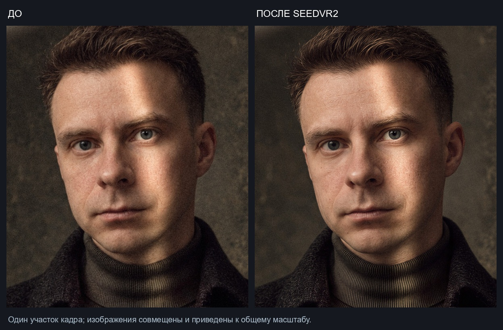
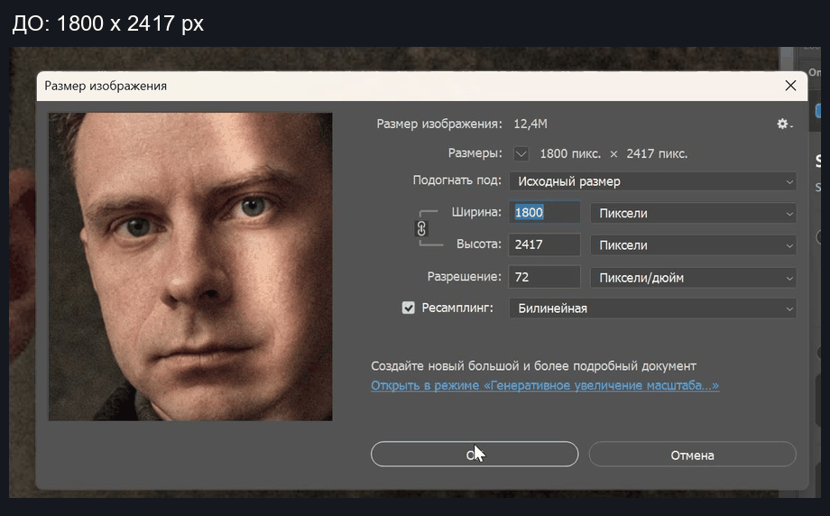
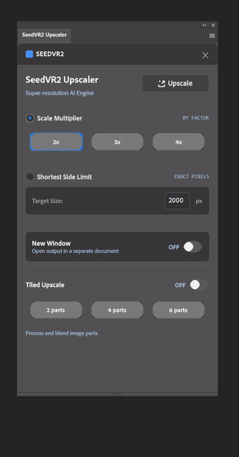

# SeedVR2 Upscaler for Adobe Photoshop

**v0.2.0 · Local AI upscaling · ComfyUI · Tiled Upscale**

Увеличивайте фотографии прямо из Photoshop: целиком или только в выделенной области. Обработка идёт локально через ComfyUI и SeedVR2.

**Новое в 0.2.0:** апскейл по **2, 4 или 6 частям** с перекрытиями и плавной сборкой. Можно получить изображение около 4K и выше, не отправляя весь большой кадр в модель за один проход.

[Скачать для Windows](https://github.com/kuznetsovphotographer-prog/photoshop-seedvr2-plugin/releases/download/v0.2.0/SeedVR2-Upscaler-v0.2.0-Windows.zip) · [Установка](docs/INSTALLATION_RU.md) · [Как пользоваться](docs/USAGE_RU.md) · [GIF-демонстрации](docs/DEMONSTRATIONS_RU.md) · [Что изменилось](RELEASE_NOTES_v0.2.0.md)

*Фрагменты предоставлены автором. Для сравнения они совмещены и приведены к общему масштабу, без дополнительной резкости и ретуши. Это не попиксельное сравнение 1:1. [Исходный фрагмент](media/images/before-detail.jpg) · [Результат](media/images/after-detail.jpg).*

## Скачать 0.2.0

| Файл | Для чего |
| --- | --- |
| [Windows ZIP](https://github.com/kuznetsovphotographer-prog/photoshop-seedvr2-plugin/releases/download/v0.2.0/SeedVR2-Upscaler-v0.2.0-Windows.zip) | Рекомендуемый комплект: CCX, установка, удаление, инструкция и API workflow |
| [Готовый CCX](https://github.com/kuznetsovphotographer-prog/photoshop-seedvr2-plugin/releases/download/v0.2.0/com.local.photoshop.seedvr2-upscaler_PS.ccx) | Установка через Adobe Creative Cloud |
| [Установщик BAT](ccx/INSTALL_SEEDVR2_UPSCALER.bat) · [Удаление BAT](ccx/UNINSTALL_SEEDVR2_UPSCALER.bat) | Для Windows; установщику нужен CCX в той же папке |
| [Workflow ComfyUI](workflows/workflows-for-comfyui/seedvr2_simple_image_upscale_api.json) | Узлы и модели нужно подготовить отдельно |
| [SHA256](ccx/SHA256SUMS.txt) | Контрольные суммы файлов |

Сначала распакуйте ZIP целиком. Не запускайте BAT из окна архива. [Предыдущая версия 0.1.1](https://github.com/kuznetsovphotographer-prog/photoshop-seedvr2-plugin/releases/tag/v0.1.1) остаётся доступна отдельно.

## Что Даёт Tiled Upscale

| Обычный апскейл | Апскейл по частям |
| --- | --- |
| В модель уходит весь кадр или рамка выделения | В модель по очереди уходят 2, 4 или 6 фрагментов |
| Предел 2500 px по короткой стороне результата | Предел 2500 px по короткой стороне **каждой части**, включая перекрытие |
| Один запрос SeedVR2 | Несколько последовательных запросов и сборка одного PNG |
| Подходит для небольших изображений | Помогает обрабатывать крупный кадр меньшими фрагментами |

Части берутся с запасом по краям: перекрытие до 128 исходных пикселей. После обработки плагин совмещает их и смешивает пересечения плавными весами с учётом прозрачности.

Такой режим может снизить пиковый расход видеопамяти на обработку кадра. Особенно полезно, если модель уже запускается, но целое изображение слишком велико. **Память для весов модели всё равно нужна:** комплект использует тяжёлую 7B FP16, поэтому работа на видеокартах с малым объёмом VRAM не гарантируется. Больше частей также не означает более быструю обработку.

Стыки могут оставаться заметными: соседние генерации иногда различаются деталями и оттенками. Проверяйте лицо, текст и границы при 100%.

## Реальный Пример: Выше 4K По Длинной Стороне

В записи автора: **1800 × 2417 → 3600 × 4834 px**, режим **2x**, **4 части**. Это двукратный рост ширины и высоты, то есть примерно вчетверо больше пикселей. Количество частей не умножает масштаб повторно.

Итоговый размер зависит от исходника, количества частей, перекрытий и выбранной цели. До запуска он показан внизу панели. Если появился текст `2500 px limit per part`, выбранный множитель был ограничен.

## Панель И Запуск

<table>
<tr>
<td width="38%" valign="top">

</td>
<td valign="top">

1. Запустите ComfyUI на `http://127.0.0.1:8188`.
2. Откройте фотографию; при необходимости создайте выделение.
3. Выберите `2x / 3x / 4x` или `Shortest Side Limit`.
4. Выберите `New Window`: новый документ или возврат в исходный.
5. Включите `Tiled Upscale` и выберите `2 / 4 / 6 parts`.
6. Проверьте рассчитанный размер и нажмите `Upscale`.

При выключенном `Tiled Upscale` работает обычный апскейл. Нажатие кнопки частей сразу включает tiled-режим. Настройки запоминаются.

</td>
</tr>
</table>

[Статичный снимок панели крупно](media/images/plugin-panel-v0.2.0.jpg) · [Все демонстрации](docs/DEMONSTRATIONS_RU.md)

`Scale Multiplier` масштабирует каждую часть в 2, 3 или 4 раза, пока не сработает лимит. В tiled-режиме `Shortest Side Limit` задаёт **500–2500 px для короткой стороны части**, а не всей сборки.

## Куда Попадает Результат

Обычный и tiled-режим поддерживают все четыре сценария:

| Источник | New Window OFF | New Window ON |
| --- | --- | --- |
| Весь документ | Замена текущего документа увеличенной картинкой. Одно Undo восстанавливает исходное состояние и слои. | Увеличенный результат в новом документе; исходник не меняется. |
| Выделение | Новый слой `SeedVR2 Upscale` в **старых границах выделения**; размер исходного документа не меняется. | Увеличенная рамка выделения в новом документе. |

Для любого непустого выделения используется его прямоугольная рамка. Прогресс общий для всех частей: `Part 2/4`, `Stitching...`, `Applying...`. Кнопка `Stop` прерывает текущую задачу и не запускает оставшиеся части.

Если готовый PNG не удалось вернуть в Photoshop, появляется **Open Last Result**. Он открывает завершённый результат новым документом без повторной генерации. Воспользуйтесь им до закрытия или перезагрузки плагина.

## Установка За Несколько Шагов

1. Подготовьте локальный ComfyUI и узлы [ComfyUI-SeedVR2_VideoUpscaler](https://github.com/numz/ComfyUI-SeedVR2_VideoUpscaler).
2. Проверьте [API workflow](workflows/workflows-for-comfyui/seedvr2_simple_image_upscale_api.json) на небольшом изображении в самом ComfyUI.
3. Скачайте и полностью распакуйте [Windows ZIP 0.2.0](https://github.com/kuznetsovphotographer-prog/photoshop-seedvr2-plugin/releases/download/v0.2.0/SeedVR2-Upscaler-v0.2.0-Windows.zip).
4. Закройте Photoshop. Если использовали Developer Tool, сначала сделайте `Unload` старого экземпляра.
5. Запустите `INSTALL_SEEDVR2_UPSCALER.bat` и подтвердите запрос прав Windows.
6. Откройте Photoshop: `Plugins → SeedVR2 Upscaler → SeedVR2 Upscaler`.

[Подробная инструкция с GIF](docs/INSTALLATION_RU.md) · [Установка и первый запуск в картинках](docs/DEMONSTRATIONS_RU.md)

## Требования

- Windows и Adobe Creative Cloud Desktop.
- Photoshop **24.0+** для обычного режима, **24.4+ с Imaging API** для обработки по частям, **25.0+** для Photoshop Actions.
- ComfyUI на `127.0.0.1:8188`, узлы SeedVR2 и совместимая NVIDIA CUDA-видеокарта.
- Достаточно VRAM для выбранной модели, оперативной памяти и места на scratch-диске Photoshop для сборки.

В комплекте используются `seedvr2_ema_7b_fp16.safetensors` и `ema_vae_fp16.safetensors`. Модели в ZIP не входят. Первый запуск может занять больше времени из-за скачивания и загрузки весов. Точный минимальный объём VRAM для разных видеокарт не заявляется.

Workflow сохранён: VAE encode/decode tiling `1024`, overlap `128`, `uniform_batch_size: true`, `batch_size: 1`, цветокоррекция `lab`, alpha-цепочка. Torch Compile не добавлен. Для иных моделей, FP8 или GGUF нужно отдельно проверить совместимый workflow.

## Actions И Документация

В Photoshop Actions записываются режим размера, множитель, точная короткая сторона, `New Window`, состояние `Tiled Upscale` и количество частей. Новый запуск выбирает новый seed; внутри одной tiled-операции seed общий для всех частей. Старые экшены без tiled-настроек продолжают выполнять обычный апскейл.

- [Установка и обновление](docs/INSTALLATION_RU.md)
- [Размеры, части, выделение, New Window и Undo](docs/USAGE_RU.md)
- [Все новые GIF-демонстрации](docs/DEMONSTRATIONS_RU.md)
- [Photoshop Actions и пакетная обработка](docs/ACTIONS_RU.md)
- [Ошибки, VRAM и Open Last Result](docs/TROUBLESHOOTING_RU.md)
- [Исходники, тесты и сборка CCX](docs/DEVELOPMENT_RU.md)

## Ограничения

SeedVR2 генерирует детали, а не восстанавливает гарантированно точный оригинал. Больше частей не гарантирует меньше галлюцинаций. Сборка tiled-результата выполняется в **sRGB, 8-bit RGBA**. Технический предел PNG в плагине: **30000 px по каждой стороне**; реальный доступный размер зависит от памяти.

Не меняйте исходный документ во время обработки. Перед возвратом плагин проверяет его ID, размеры и историю, чтобы не затереть изменённую работу. Без выделения и с `New Window OFF` результат сводится в один слой; восстановление исходных слоёв доступно через Undo.

Плагин не является официальным продуктом Adobe, ComfyUI или авторов SeedVR2. Отдельная лицензия кода пока не указана; права сохраняются за автором. Модели и сторонние проекты распространяются на своих условиях.

## Благодарности

[SeedVR2 / ByteDance-Seed](https://github.com/ByteDance-Seed/SeedVR) · [ComfyUI](https://github.com/comfyanonymous/ComfyUI) · [Узлы SeedVR2 / numz](https://github.com/numz/ComfyUI-SeedVR2_VideoUpscaler)
