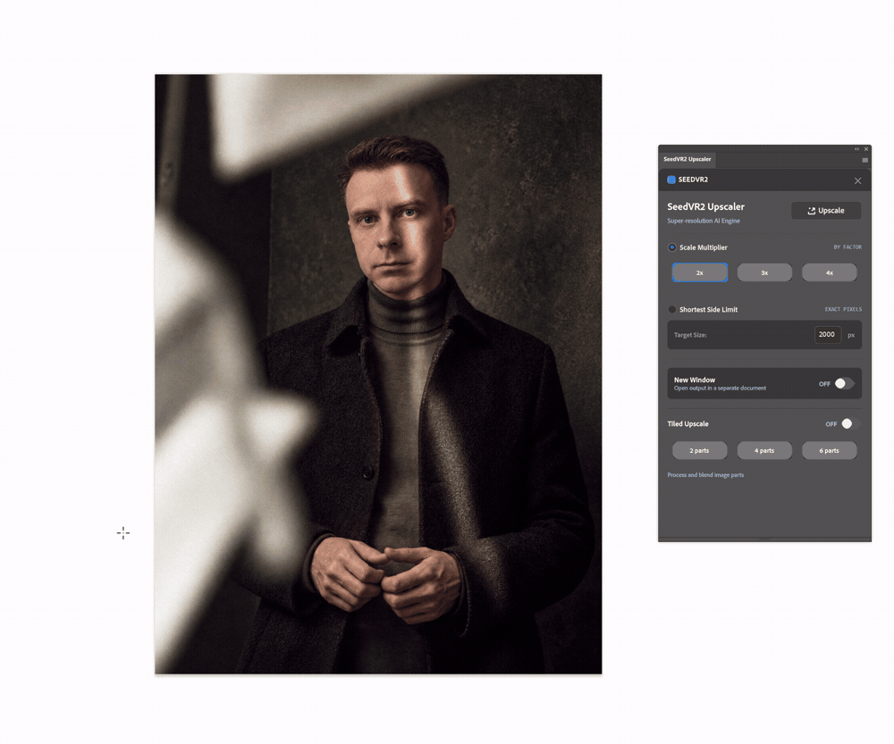
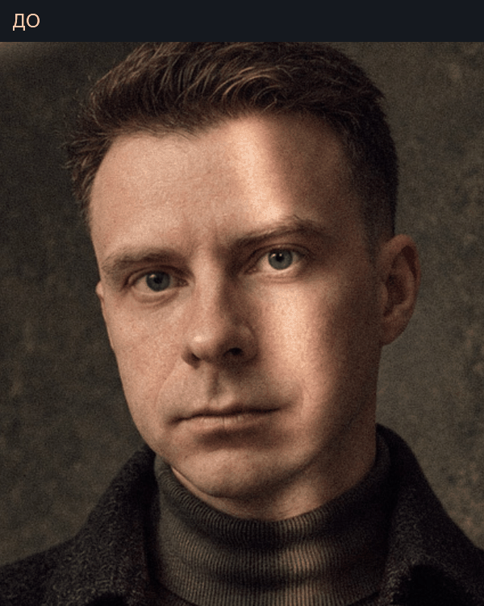
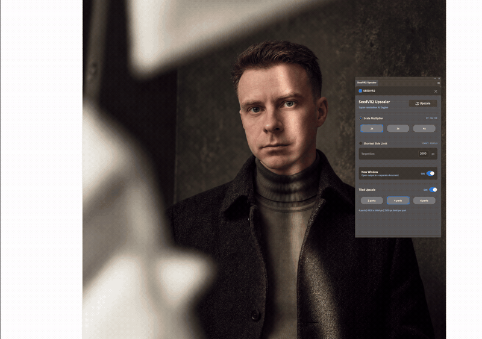

# Демонстрации SeedVR2 0.2.0

Все новые демонстрации опубликованы в GIF. Они подготовлены из семи записей экрана автора: фрагменты укорочены и обрезаны вокруг нужных элементов. Исходные MP4 в репозиторий не загружаются.

GIF не передаёт звук и ограничивает цвета, поэтому для оценки деталей рядом доступны JPEG. Скорость GIF и склейки не предназначены для измерения времени генерации.

## 1. Установка

Закройте Photoshop, распакуйте комплект и запустите `INSTALL_SEEDVR2_UPSCALER.bat`. В записи показан запуск установщика и его завершение. Требуются Adobe Creative Cloud Desktop и подтверждение прав Windows.

[Полная инструкция](INSTALLATION_RU.md)

## 2. Где Открыть Плагин

Меню Photoshop: `Plugins → SeedVR2 Upscaler → SeedVR2 Upscaler`. В русской локализации меню называется «Подключаемые модули».

## 3. Настройки Частей

Реальная панель Photoshop: размеры, New Window, Tiled Upscale и выбор 2/4/6 частей. Нажатие кнопки частей сразу включает tiled-режим.

  

[Панель крупно](../media/images/plugin-panel-v0.2.0.jpg)

## 4. Запуск ComfyUI

На записи автор запускает ComfyUI через Stability Matrix. Это один из вариантов: подходит и другая локальная установка, если сервер работает на `127.0.0.1:8188` и совместимый workflow выполняется.

## 5. Запуск Обработки По Четырём Частям

Выбор режима и запуск из Photoshop. В GIF оставлен короткий фрагмент записи, а не полное ожидание генерации всех частей. Части отправляются последовательно; готовый результат собирается после выполнения всех запросов.

## 6. До И После

Фрагменты исходника и результата совмещены и приведены к одному масштабу. Дополнительная резкость и ретушь не применялись. Это сравнение области кадра, а не исходных пикселей 1:1.

[До, JPEG](../media/images/before-detail.jpg) · [После, JPEG](../media/images/after-detail.jpg) · [Фотография источника, JPEG](../media/images/source-photo.jpg)

Осмотр результата в Photoshop, GIF из записи экрана

На записи меняется масштаб просмотра. Для сравнения при одинаковом размере используйте изображения выше.

## 7. Подтверждение Разрешения

Два кадра из записи «Размер изображения»: исходник **1800 × 2417 px**, результат **3600 × 4834 px**. Выбраны 2x и четыре части.

[Размер исходника](../media/images/source-size.jpg) · [Размер результата](../media/images/result-size.jpg)

По длинной стороне результат превышает 4K; формат и пропорции фотографии сохранены. Это пример, а не обещание фиксированного размера для любого исходника.

## Материалы

Автор предоставил записи и фотографии для публикации проекта. Карта источников и обработки: [media/README.md](../media/README.md). Старый пример локального улучшения выделения сохранён в [local-selection-demo.gif](../media/gif/local-selection-demo.gif).
