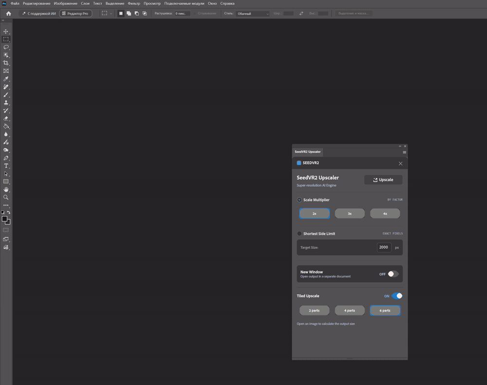
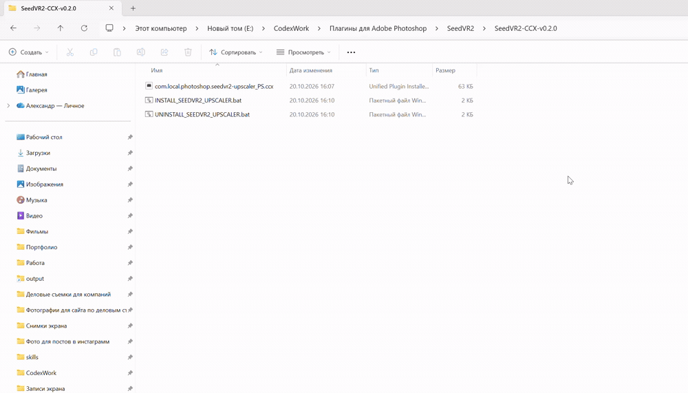
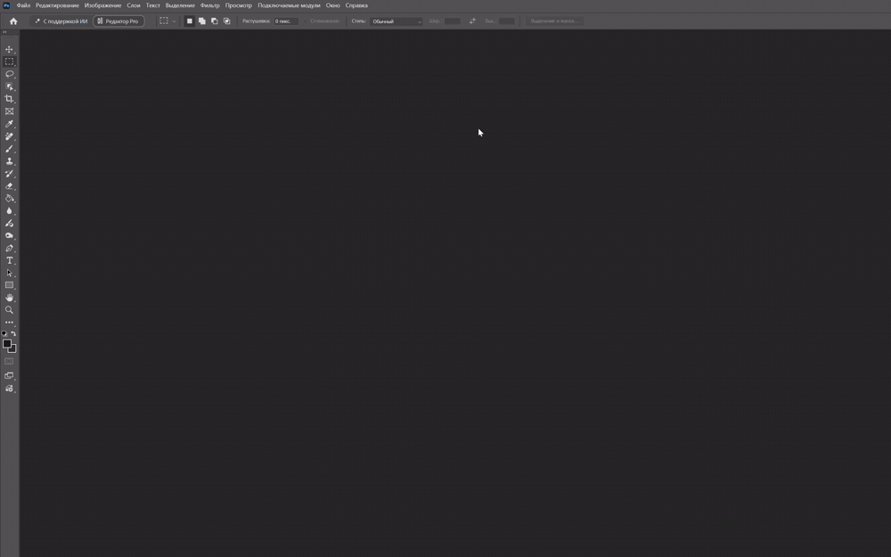

# Установка SeedVR2 Upscaler 0.2.0

## Что Понадобится

- Windows и Adobe Creative Cloud Desktop.
- Photoshop 24.0+; для Tiled Upscale нужен 24.4+ с Imaging API, для Actions нужен 25.0+.
- ComfyUI, совместимые узлы SeedVR2, NVIDIA CUDA-видеокарта.
- Место для моделей, свободная VRAM и оперативная память.

Встроенный профиль использует **7B FP16**. Обработка по частям уменьшает размер кадра на один запрос, но не уменьшает веса модели и не гарантирует запуск на любой видеокарте.

## 1. Подготовьте ComfyUI

Установите узлы [ComfyUI-SeedVR2_VideoUpscaler](https://github.com/numz/ComfyUI-SeedVR2_VideoUpscaler) через менеджер узлов вашей сборки. После установки зависимостей перезапустите ComfyUI.

В проверенном шаблоне указаны модели:

```text
seedvr2_ema_7b_fp16.safetensors
ema_vae_fp16.safetensors
```

Узлы могут скачивать их при первом запуске. Модели в комплект плагина не включены.

Проверьте узлы и модели на небольшой фотографии непосредственно в ComfyUI. [Приложенный JSON](../workflows/workflows-for-comfyui/seedvr2_simple_image_upscale_api.json) является **API-шаблоном**, а не гарантированно импортируемой схемой редактора для всех версий frontend. В нём имя изображения в LoadImage служит примером; при ручном запуске замените его своим. Плагин подставляет загруженный PNG автоматически.

Для работы плагина сервер должен быть доступен по адресу:

```text
http://127.0.0.1:8188
```

На GIF автор запускает ComfyUI через Stability Matrix. Допустима другая локальная сборка на том же адресе.



## 2. Скачайте Комплект

Скачайте [SeedVR2-Upscaler-v0.2.0-Windows.zip](https://github.com/kuznetsovphotographer-prog/photoshop-seedvr2-plugin/releases/download/v0.2.0/SeedVR2-Upscaler-v0.2.0-Windows.zip) и распакуйте его целиком в обычную папку.

В комплекте:

```text
com.local.photoshop.seedvr2-upscaler_PS.ccx
INSTALL_SEEDVR2_UPSCALER.bat
UNINSTALL_SEEDVR2_UPSCALER.bat
README_RU.md
INSTALLATION_RU.txt
seedvr2_simple_image_upscale_api.json
```

Не запускайте установщик из ZIP. CCX и BAT должны лежать рядом. Не путайте этот комплект с автоматически создаваемым GitHub архивом Source code: он содержит весь репозиторий, а не только установку.

Контрольные суммы доступны в [SHA256SUMS.txt](../ccx/SHA256SUMS.txt). Например:

```powershell
Get-FileHash .\SeedVR2-Upscaler-v0.2.0-Windows.zip -Algorithm SHA256
```

## 3. Установите Плагин

1. Если использовали UXP Developer Tool, сделайте **Unload** загруженного SeedVR2.
2. Закройте Photoshop.
3. Запустите `INSTALL_SEEDVR2_UPSCALER.bat`.
4. Проверьте имя файла и подтвердите запрос прав Windows.
5. После приглашения в консоли нажмите любую клавишу.
6. Дождитесь сообщения `SeedVR2 Upscaler 0.2.0 package installed successfully.`
7. Запустите Photoshop.

BAT вызывает официальный установщик Adobe UPIA. Creative Cloud Desktop должен быть установлен. Если Windows показывает предупреждение безопасности, убедитесь, что пакет скачан из этого репозитория; не отключайте защиту системы.



Также можно открыть CCX двойным щелчком и подтвердить установку в Creative Cloud Desktop. BAT полезен, если ассоциация CCX не сработала.

## 4. Откройте Панель

В английской локализации:

```text
Plugins -> SeedVR2 Upscaler -> SeedVR2 Upscaler
```

В русской локализации меню называется **Подключаемые модули**.



## 5. Проверьте Новую Версию

1. Убедитесь, что внизу есть **Tiled Upscale** и кнопки **2 parts / 4 parts / 6 parts**.
2. Откройте небольшое тестовое изображение, выберите 2x и New Window ON.
3. Сначала проверьте обычный режим с Tiled OFF.
4. Включите Tiled, выберите 4 parts, проверьте размер внизу и повторите.
5. Дождитесь открытия результата; проверьте размеры через Image Size.
6. Затем проверьте New Window OFF и Undo на копии документа.

Не меняйте оригинал во время рендера. [Режимы и ограничения](USAGE_RU.md).

## Обновление С 0.1.1

Идентификатор плагина тот же: `com.local.photoshop.seedvr2-upscaler`. Закройте Photoshop и установите 0.2.0 поверх прежней версии. Старые настройки читаются без сброса; новые tiled-настройки по умолчанию выключены.

Если Adobe не заменил пакет, закройте Photoshop, запустите `UNINSTALL_SEEDVR2_UPSCALER.bat`, затем установщик новой версии. Две копии с одним ID одновременно загружать нельзя.

## Удаление

Закройте Photoshop и запустите `UNINSTALL_SEEDVR2_UPSCALER.bat`, подтвердите права и приглашение в консоли. Файл удаляет установленную Photoshop-панель, но не ComfyUI и его модели. Developer Tool-копию выгружайте отдельно через Unload.

## Для Разработчиков

В UXP Developer Tool: `Add Plugin` → `plugin/photoshop-seedvr2-plugin/manifest.json` → `Load`. Сначала выгрузите прежний экземпляр. После правок используйте Unload → Load.

[Разработка и сборка](DEVELOPMENT_RU.md) · [Если что-то не работает](TROUBLESHOOTING_RU.md)
